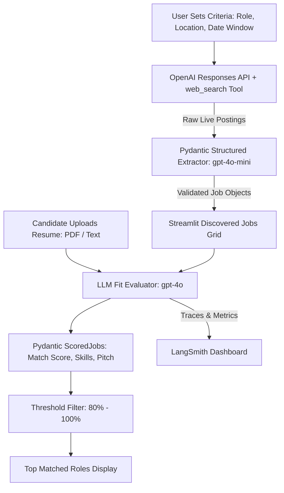

# 💼 AI Job Hunter & Resume Matcher

[](https://www.python.org/)
[](https://www.langchain.com/)
[](https://streamlit.io/)
[](https://smith.langchain.com/)
[](LICENSE)

An intelligent agentic application that **autonomously searches live tech career platforms** (LinkedIn, Greenhouse, Lever, and official portals), extracts job details into **strictly validated Pydantic models**, and **evaluates candidate resumes** against active roles to provide personalized fit scores and tailored outreach pitches.

---

## 🌟 Key Features

- **🌐 Live Web Search**: Leverages OpenAI's native Responses API with the `web_search` tool to query live job boards without brittle web scrapers.
- **🗓️ Dynamic 14-Day Time Window**: Calculates runtime dates to automatically discard expired, duplicate, or stale postings older than two weeks.
- **🛡️ Pydantic Structured Output**: Guarantees clean, typed extractions (`title`, `company`, `location`, `posted_date`, `skills`, `url`, `summary`).
- **📄 Resume PDF & Text Ingestion**: Drag-and-drop resume upload (PDF or text) with automatic page extraction using `pypdf`.
- **🎯 80%–100% Match Threshold Slider**: Focus exclusively on high-probability opportunities with an adjustable minimum fit score.
- **✍️ 1-Click Tailored Pitch**: Automatically drafts a custom 3-bullet outreach note highlight-matching your specific achievements for each role.
- **📊 Full LangSmith Observability**: End-to-end tracing of token counts, tool calls, and model latency out of the box.

---

## 🏗️ Architecture & Workflow



---

## 📁 Project Structure

```text
ai-job-hunter/
├── app.py              # Interactive Streamlit Web Dashboard
├── job_agent.py        # Core agent: search, Pydantic schemas, and resume scorer
├── main.py             # CLI runner and headless entry point
├── pyproject.toml      # Modern packaging configuration (uv / hatchling)
├── requirements.txt    # Standard pip dependencies for cloud deployments
├── .env.example        # Environment variable template
├── .gitignore          # Git exclusion rules
├── LICENSE             # MIT License
└── README.md           # Documentation and setup guide
```

---

## 🚀 Quickstart Guide

### 1. Clone the Repository
```bash
git clone https://github.com/your-username/ai-job-hunter.git
cd ai-job-hunter
```

### 2. Set Up Environment & Dependencies

#### Using `uv` (Recommended):
```bash
# Create venv and install dependencies
uv sync

# Or install manually
uv venv
source .venv/bin/activate
uv pip install -r requirements.txt
```

#### Using standard `pip`:
```bash
python3 -m venv .venv
source .venv/bin/activate
pip install -r requirements.txt
```

### 3. Configure API Keys
Copy the example environment file and add your credentials:
```bash
cp .env.example .env
```

Edit `.env`:
```env
OPENAI_API_KEY=your_openai_api_key_here

# Optional: LangSmith Tracing
LANGSMITH_TRACING=true
LANGSMITH_ENDPOINT=https://api.smith.langchain.com
LANGSMITH_API_KEY=your_langsmith_api_key_here
LANGSMITH_PROJECT=ai-job-hunter
```

---

## 🖥️ Running the Application

### Option A: Interactive Streamlit Dashboard (Web UI)
```bash
streamlit run app.py
```
Open your browser to `http://localhost:8501`.

1. **Step 1:** Click **Discover Jobs** to search live listings from the past 14 days.
2. **Step 2:** Upload your **Resume (PDF or TXT)**.
3. **Step 3:** Adjust the **Match Score Slider** (80%–100%) in the sidebar.
4. **Step 4:** Click **🚀 Run Candidate Matching** to view matched skills, growth areas, and 1-click tailored pitches!

---

### Option B: Command-Line Interface (CLI)
```bash
python main.py
```
Runs an end-to-end demo searching for Bay Area Data Engineering roles and scoring them against a candidate profile directly in the terminal.

---

## 📊 LangSmith Observability

When `LANGSMITH_TRACING=true` is enabled in your `.env`, all web search queries, Pydantic extraction calls, latency, and token consumption are recorded in [LangSmith](https://smith.langchain.com/):

- Inspect the exact web search tool arguments and citations.
- Debug and optimize prompt token usage.
- Monitor execution latencies across models (`gpt-5-mini` vs `gpt-4o`).

---

## ☁️ Deployment

### Streamlit Community Cloud
1. Push this repository to GitHub.
2. Navigate to [share.streamlit.io](https://share.streamlit.io/).
3. Connect your repository, set the main file path to `app.py`.
4. In **Advanced Settings**, add your `OPENAI_API_KEY` under Secrets.
5. Deploy!

---

## 📜 License

This project is licensed under the [MIT License](LICENSE).
